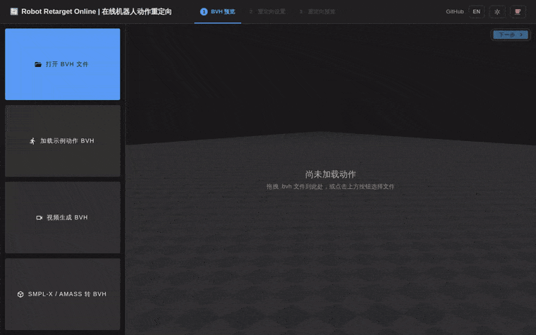

# Robot_Retarget_Online

机器人动作在线重定向 / Browser-based motion retargeting for humanoid and quadruped robots.

[**在线体验**](https://imchong.github.io/Robot_Retarget_Online/) · [**机器人兼容性报告**](docs/gallery-compat/README.md)

**BVH / SMPL-X 动作输入 → GMR / OmniRetarget 重定向 → 3D 预览 → NPZ / CSV / JSON 导出。**

支持人形与四足机器人，可从 [Robot Description Gallery](https://github.com/ImChong/Robot_Description_Gallery_Online) 选择 URDF；所有计算在浏览器内完成，无需安装或后端。

基于 [GMR](https://github.com/YanjieZe/GMR)、[OmniRetarget](https://omni-retarget.github.io/) 与 [MuJoCo](https://github.com/google-deepmind/mujoco)。本仓库代码采用 [MIT License](LICENSE)；示例动作和第三方机器人资产遵循各自许可证。
